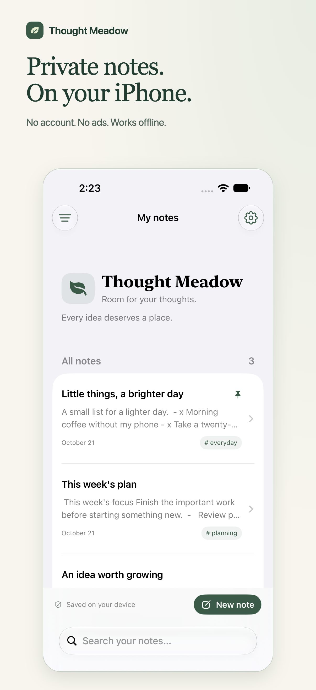
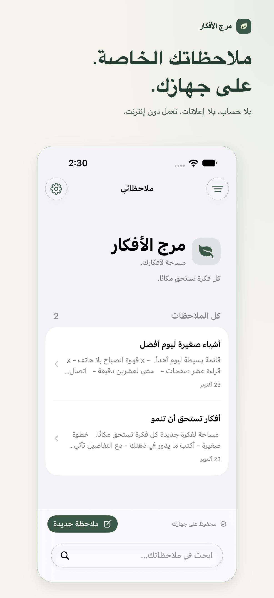
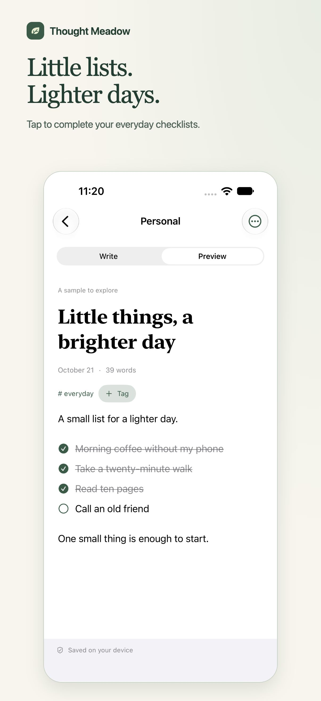
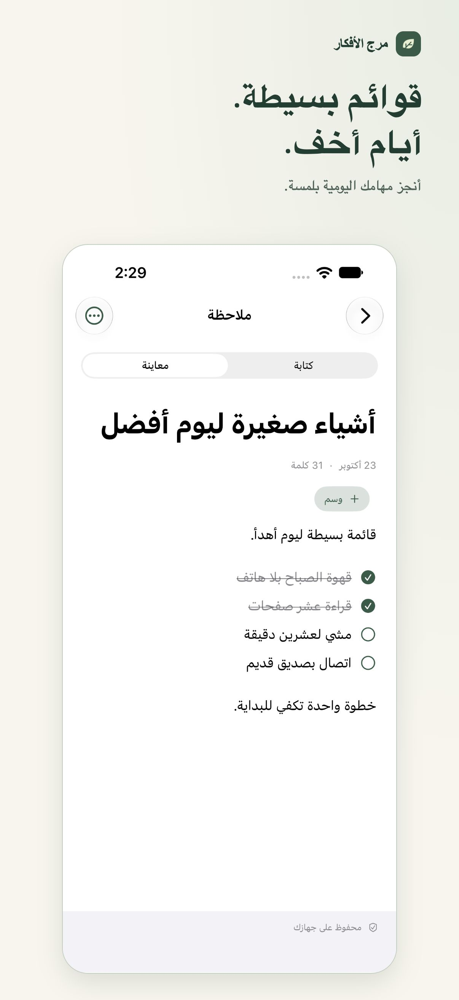
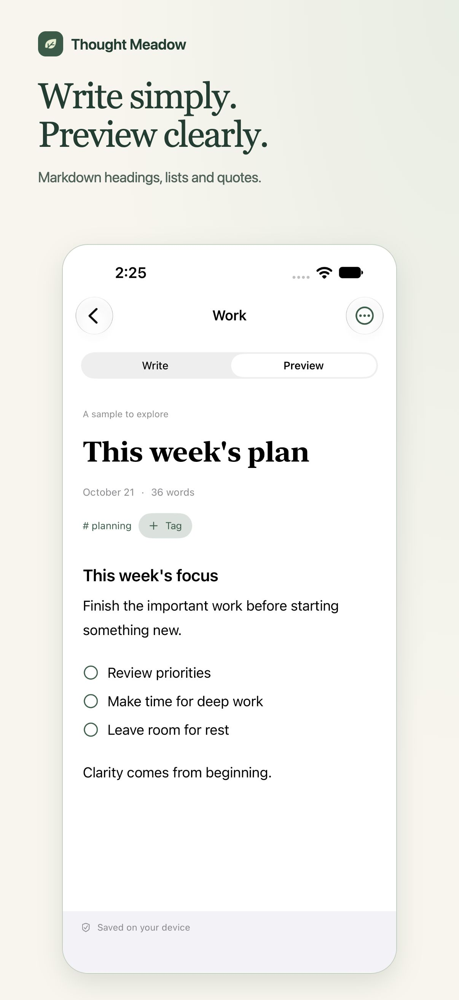
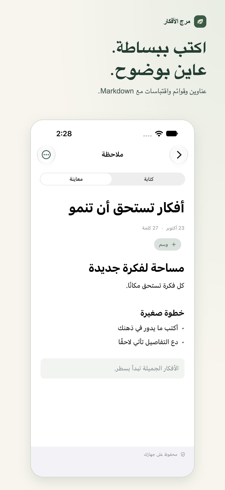
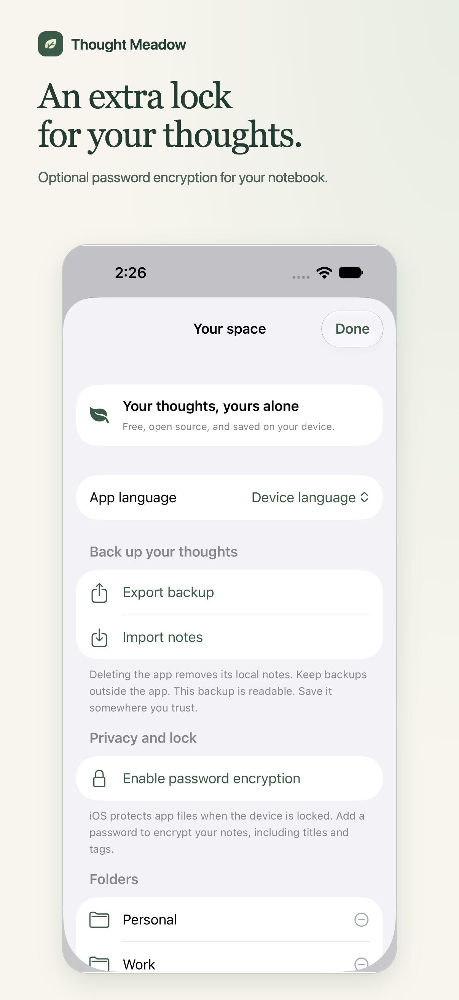
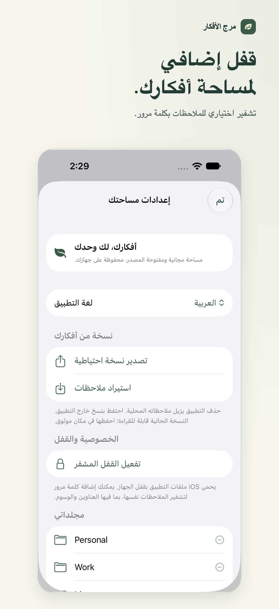

# Thought Meadow — App Store screenshots

Prepared on 23 October 2026 after feedback in r/iOSAppsMarketing: explain each benefit alongside the actual app, and provide a separate Arabic set with right-to-left layout.

Eight RGB JPEG assets, each 1206 × 2622 pixels. All screens were captured from the released native app, 1.0.0 (4), using fictional demo notes. Captions describe features that are available today. Password encryption is optional.

These are prepared replacement assets. They have not yet been applied to the live App Store page as of 23 October 2026; Apple submission and approval are separate from publishing them here.

| Feature | English | العربية |
| --- | --- | --- |
| Local notes, no account or ads |  |  |
| Interactive checklists |  |  |
| Markdown preview |  |  |
| Optional password encryption |  |  |
